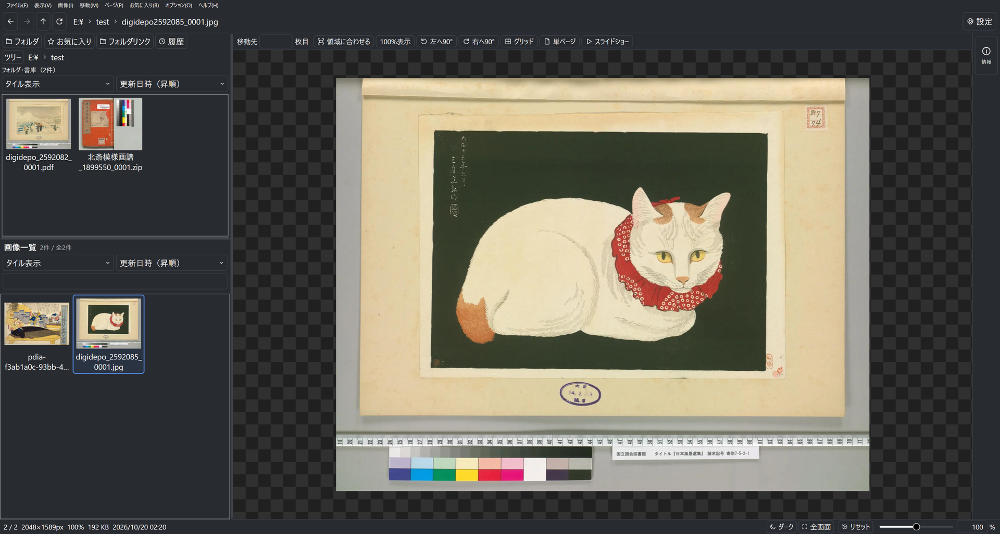

# StellaViewer

**[ダウンロード](https://github.com/amae-yoshino/StellaViewer/releases/download/v0.2.0-preview.13/StellaViewer-0.2.0-preview.13-win-x64.zip)** · [リリース情報](https://github.com/amae-yoshino/StellaViewer/releases/tag/v0.2.0-preview.13)

Windows 11 x64向けの、C#／WPF製画像ビューアです。通常フォルダ、書庫、PDFを閲覧できます。現在は **0.2.0-preview.13** です。

本体は **MITライセンス**です。商用利用・改変・再配布が可能です。第三者ソフトウェアには個別の条件が適用されます。[LICENSE.txt](LICENSE.txt) と [外部ライブラリ一覧](docs/dependencies.md) を確認してください。

## 主な機能

- JPEG、PNG／APNG、BMP、GIF、WebP、PSDの合成画像、CLIPの保存済み画像の表示
- ZIP／CBZ、7z、RAR／CBRと書庫内フォルダ・入れ子書庫、通常PDF・書庫内PDFの閲覧
- 単ページ／見開き、回転、全画面、ルーペ、グリッド、スライドショー
- 名前・詳細・タイル一覧、自然順の名前検索と並べ替え。フォルダを先に、書庫・PDFを後に表示
- 履歴・お気に入り・フォルダリンク、スクロールと選択の復帰、先読み・容量制限付きキャッシュ
- ライト／ダークテーマ、UI・文字・サムネイルのサイズ、複数ショートカットの設定
- コピーとゴミ箱への移動・取り消し。削除機能は初期状態で無効

## 導入と更新

利用には **Windows 11 x64** と **.NET 10 Desktop Runtime x64** が必要です。Visual Studioや.NET SDKは不要です。

1. Microsoft公式の [.NET 10ダウンロード](https://dotnet.microsoft.com/ja-jp/download/dotnet/10.0) で「.NET デスクトップ ランタイム」のWindows x64を導入します。
2. 配布時に提供される `StellaViewer-0.2.0-preview.13-win-x64.zip` をフォルダごと展開します。
3. 展開先の `StellaViewer.exe` を起動します。DLL・licensesを含むフォルダ全体が必要です。

更新時はアプリを終了し、**別の新しいフォルダへ展開**して起動します。設定等は `%LOCALAPPDATA%\StellaViewer` に保存されます。自動更新機能はありません。詳しくは[導入・更新手順](docs/installation.md)を参照してください。

## 主な制限

- TAR系、暗号化・分割書庫、パスワード付きPDFは非対応です。
- PSDはRGB 8／16bit・合成画像のRaw／RLEが対象です。CLIPは保存済みプレビューを使い、全編集情報は再現しません。
- 表示用画素は原則1枚256 MiBまで。これはプロセス全体のメモリ上限ではありません。アニメーション、書庫一時展開にも別の上限があります。
- PDFは144 dpiで描画し、100%表示は描画後の画素等倍です。
- 信頼できない画像・書庫・PDFは、外部ライブラリを介して利用者の権限で解析します。完全なサンドボックスではありません。

詳しい操作方法は[利用ガイド](docs/distribution/README.txt)、変更内容は[更新履歴](CHANGELOG.md)を参照してください。

## 第三者ソフトウェアと再配布

本体のMITライセンスは、Magick.NET／ImageMagick、SharpCompress、PDFtoImage／PDFium／SkiaSharp、bzPSD、SQLite等の条件を置き換えません。画像ライブラリの一部にはLGPL等が含まれます。

外部部品のライセンスは [THIRD-PARTY-NOTICES.md](THIRD-PARTY-NOTICES.md) と [外部ライブラリ一覧](docs/dependencies.md)を参照してください。
